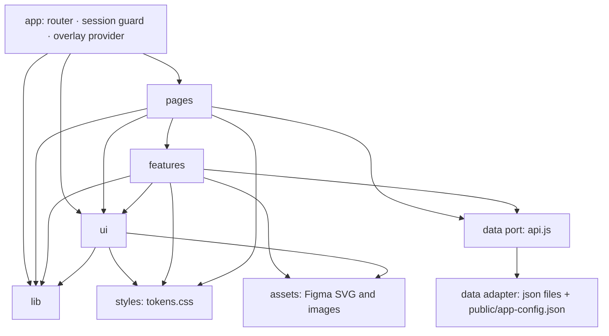
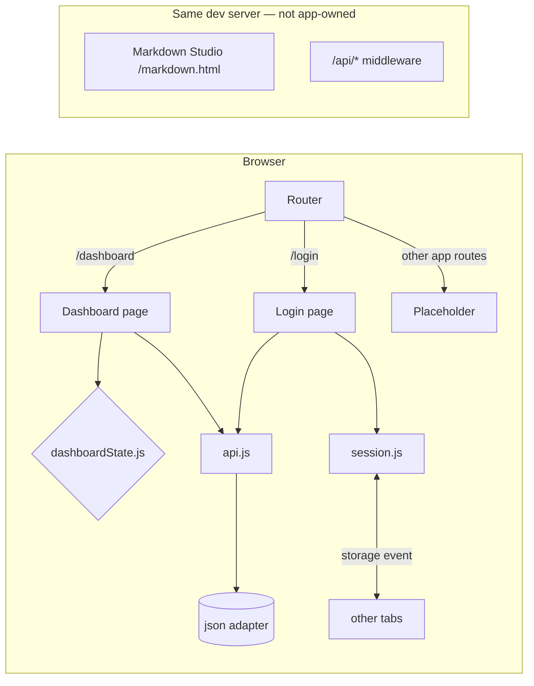

# Architecture Spine — AGI SureTrack Farm Web (Login & Dashboard)

## Design Paradigm

**Layered SPA with ports-and-adapters data access.** A layer may depend only on layers below it. Screens get data only through the data port, never from JSON files directly.

| Layer | Directory | Holds |
| --- | --- | --- |
| App | `src/app/` | Router, route table, session guard, overlay root |
| Pages | `src/pages/` | `Login`, `Dashboard`, `Placeholder`: compose features, own no styling values |
| Features | `src/features/` | `auth/`, `forgot-password/`, `shell/` (Header, profile menu), `dashboard/` (cards), `notifications/` |
| UI primitives | `src/ui/` | Card shell, Fill bar, Health bar, Runtime chart, Empty state, Filter chip, Toggle, Icon |
| Domain logic | `src/lib/` | `geometry.js` (chart px), `session.js`, `dashboardState.js`, `copy.js` |
| Data port | `src/data/api.js` | `getUsers()`, `getDashboard(state)`, `getNotifications()` |
| Data adapter | `src/data/json/` | `users.json`, `dashboard.{full,small,allgood}.json`, `notifications.json` |
| Design tokens | `src/styles/` | `tokens.css`, `fonts.css`, `reset.css` |
| Assets | `src/assets/` | Exported Figma SVGs, `login-bg.webp` and `.jpg`, avatar |

## Invariants & Rules



*Arrows are the only allowed import directions:*
- *Nothing imports `src/data/json/*` except `api.js`.*
- *Nothing imports `pages/` or `app/` from below.*
- *Features never import other features. Cross-feature composition happens in `pages/` or `app/` through props and slots.*
- *`lib/` is pure (no React, DOM or storage), except `session.js`, the only storage owner (AD-9).*

### AD-1 — The Figma frame is the visual source of truth [ADOPTED]

- **Binds:** all FRs, the §8 Fidelity check
- **Prevents:** developers "improving" spacing, colours or readings, so the build drifts from the Reference renders
- **Rule:**
  - Every visible value comes from the PRD §4 consequences, which were extracted from the Figma frames.
  - A deviation is allowed only after a Figma revision; a PR that changes a visual value must cite the revised Figma node.
  - **Precedence:** Figma beats Jira for appearance; Jira beats Figma for undrawn behaviour; this spine's AD-14 settles PRD-internal conflicts.

### AD-2 — One token layer; components hold no colour or font literals

- **Binds:** FR-1–FR-10, every component stylesheet
- **Prevents:** three hand-typed reds, `#F3F4F6` and `#F3F4F4` drifting into one, and fonts or radii diverging across components
- **Rule:**
  - **Tokens:** `src/styles/tokens.css` defines every colour, font family, font weight, shadow, radius, z-index and opacity as CSS custom properties, named after the Figma variable (`--brand-primary-700`) or, for hard-coded Figma values, `--raw-<hex>`. Values are copied verbatim, never rounded or merged.
  - **Component CSS:** may use hex, `rgb()` or font-family literals only through `var(--…)`.
  - **Geometry:** px for position and size (including fractional values such as `14.551px` and `9.375px`) is written literally in the component CSS Module, exactly as in the PRD.

### AD-3 — CSS Modules only [ADOPTED]

- **Binds:** all UI
- **Prevents:** utility-scale rounding, global class collisions with Markdown Studio styles, and runtime style cost
- **Rule:**
  - Each component has one `*.module.css`.
  - The only global CSS is `reset.css`, `fonts.css` and `tokens.css`, imported once in `src/app/`.
  - No Tailwind, CSS-in-JS, UI kit or icon font.

### AD-4 — Fixed 1366 px design canvas

- **Binds:** NFR-1, FR-11–FR-14, FR-50–FR-53, FR-93
- **Prevents:** responsive reflow that breaks pixel parity, and different units guessing different breakpoints
- **Rule:**
  - **Canvas:** the Login page is exactly 1366×768. The Dashboard is 1366 px wide with height equal to its frame (1052 / 860 / 856), driven by `pageBottomSpacePx` from the state JSON.
  - **Wider viewports:** the canvas stays left-aligned and fixed-width, with `min-width: 1366px` on the app root.
  - **Not allowed:** media queries, `vw`/`vh`/`%`-based sizing of designed elements, and `clamp()`.
  - **Overlay exception (AD-12):** overlays sit on a `position: fixed` full-viewport layer. The Notifications panel is `height: 100dvh` and right-anchored to the 1366 canvas edge. The Forgot Password modal is centred on that layer. Inside an overlay, every designed size is still literal px.

### AD-5 — Figma assets are used unmodified

- **Binds:** NFR-3, every FR with an icon, logo or image
- **Prevents:** redrawn or "cleaned-up" icons, recoloured SVGs, raster icons
- **Rule:**
  - **SVGs:** come only from `figma-assets/` (copied to `src/assets/`), byte-identical, rendered as `` with explicit `width` and `height` from the PRD. They are never inlined to recolour, because each colour is baked into its file.
  - **Hand-authored exceptions:** only the right chevron (12×16, `#006A36`) and the Logout icon, which must be exported from Figma `6026:52937` before the profile menu is built.
  - **Photo:** the silo photo ships only as the 2732 px WebP and JPEG derivatives.

### AD-6 — Fonts are loaded before first paint

- **Binds:** NFR-2, FR-4, the Fidelity check
- **Prevents:** a fallback-font flash that alters glyph metrics, and baselines captured with the wrong font
- **Rule:**
  - **Bundled fonts:** Roboto weights 400, 500, 600, 700 and 800, plus Inter 400–700, from the `@fontsource` packages.
    - **No package CSS:** the packages' own CSS is never imported, because it sets `font-display: swap`.
    - **`src/styles/fonts.css`:** declares its own `@font-face` rules with `font-display: block`, pointing at `@fontsource/roboto/files/roboto-latin-<weight>-normal.woff2` (and the same pattern for Inter).
  - **SF Pro:** text uses `-apple-system, BlinkMacSystemFont, "SF Pro Text", "SF Pro Display", Inter, sans-serif`.
  - **Not allowed:** Google Fonts links or any other runtime font CDN.
  - **Fidelity tests:** they call `document.fonts.load()` for every family and weight, then `await document.fonts.ready`, before every capture.

### AD-7 — Screens render data verbatim; the data port is the only door

- **Binds:** NFR-7, FR-59–FR-101
- **Prevents:** components "fixing" contradictory readings by deriving numbers, and API swap touching screens
- **Rule:**
  - **Display strings:** rendered exactly as stored (`"7 of 24"`, `"79% full"`, `"Missing Fan Switched"`). Components never format, compute, pluralise or re-sort shown readings.
  - **Numeric fields:** feed only geometry (AD-8) and logic (state choice, filtering).
  - **Data access:** only `src/data/api.js` touches the JSON. It loads each file through `import url from './json/<file>.json?url'` plus `fetch(url)`, so a real request exists that tests can fail or intercept (FR-96).
  - **Latency:** set by `VITE_DATA_LATENCY_MS`: 300 in `npm run dev`, 0 in Vitest, Playwright and the production build. Sign-in latency (800 ms) comes from the `users.json` policy, applied in `api.js` only.
  - **Test seam:** in development and test builds only, `api.js` honours `?__fail=dashboard|notifications|users` to force a rejection.
  - **Runtime config:** `getConfig()` reads `public/app-config.json` (legal URLs, Coach number), so they change without a release (FR-20). This supersedes the PRD addendum §C idea of a bundled `src/config.js`.
  - **Shapes:** exactly PRD addendum §A and §B; any new field is added there first.

### AD-8 — Chart geometry comes from one pure module

- **Binds:** FR-65–FR-72 (Health bar), FR-78–FR-82 (Runtime chart), FR-83–FR-92 (Fill bars)
- **Prevents:** each card reimplementing formulas with different rounding, and chart libraries adding padding or easing
- **Rule:**
  - **Module:** `src/lib/geometry.js` exports pure functions `healthSegments()`, `runtimeBars()`, `grainSegments()` and `liquidSegments()`.
  - **Precedence:** explicit px from data (`barPx`, `segmentPx`, `segmentTopPx`) always wins over a formula. Otherwise the PRD formula applies with the PRD's rounding (grain segments to 1.25 px).
  - **Rendering:** charts are plain DOM or SVG from these values. No chart library, no animation.
  - **Unit tests:** assert every expected px value in PRD addendum §B.8.

### AD-9 — One Session module, shared by all tabs

- **Binds:** FR-25–FR-35, FR-56, FR-57
- **Prevents:** per-tab sessions breaking "Logout reaches every tab" (SCRUM-27 AC9), and several modules reading storage
- **Rule:**
  - **Storage:** `src/lib/session.js` is the only code that touches storage. It owns exactly two `localStorage` keys:
    - **`suretrack.session`:** `{ v: 1, username, displayName, dashboardState, issuedAt, expiresAt }`, with times as integer epoch ms (PRD addendum A.4). The password is never stored.
    - **`suretrack.signin-attempts`:** `{ count, lockedUntil }`, the FR-30 lockout counter, which survives reload.
  - **Construction and expiry:** records are built only by `createSessionRecord()`, which tests use too. Expiry (FR-34) is checked only inside `getSession(now)`, which deletes an expired record and reports `reason: 'expired'`.
  - **Redirect contract:** a guarded route sends the user to `/login` with router state `{ from, reason: 'required' | 'expired' }`. The return path travels only in that state.
  - **Logout:** clears the key, and every tab reacts to the `storage` event within 1 s.
  - **Route guard:** `RequireSession` in `src/app/` is the only route guard.
  - This **supersedes** PRD addendum §C.2's `sessionStorage`.

### AD-10 — Route table and reserved paths

- **Binds:** FR-29, FR-55, FR-57, FR-75, FR-93
- **Prevents:** link targets diverging between cards, and the app colliding with Markdown Studio in the same repo and dev server
- **Rule:**
  - **Router:** `react-router@8.5.1` in declarative mode (`BrowserRouter`), imported only from `react-router`. `react-router-dom` and `react-router/dom` are banned dependencies.
  - **Paths:** `src/lib/paths.js` (pure) is the single source of every app URL and its builder functions (e.g. `paths.equipmentDetail(id)`, `paths.alertAction(id, action)`). They are exactly the paths in PRD FR-57 and FR-75 and **supersede** PRD addendum §C.1.
  - **Route table:** `src/app/routes.jsx` builds the table from `paths.js`. Every path except `/login` and `/dashboard` renders `Placeholder`.
  - **Reserved:** the app must never define routes or files under `/api/*`, `/markdown*` or `/markdown.html`, which are owned by Markdown Studio.
  - **Navigation:** components use `paths.js` builders and never write a `/`-prefixed URL literal. `?state=` is preserved only on links back to `/dashboard`.

### AD-11 — Dashboard state resolves once

- **Binds:** FR-93–FR-96
- **Prevents:** cards reading different states, and two units each reading `?state`
- **Rule:**
  - **Resolver:** `src/lib/dashboardState.js` resolves the state as `?state=full|small|allgood`, then the Session's `dashboardState`, then `full`. An unknown value falls back to the next source.
  - **Distribution:** the Dashboard page loads one state document and passes slices down. Cards never fetch on their own.

### AD-12 — Overlays share one mechanism

- **Binds:** FR-36–FR-49 (Forgot Password modal), FR-54 (profile menu), FR-97–FR-101 (Notifications panel)
- **Prevents:** stacked overlays, inconsistent Esc and focus behaviour, and z-index wars
- **Rule:**
  - **Owner:** `src/ui/overlay/` provides `OverlayProvider` (mounted once in `app/`) and `useOverlay()`, the only holder of open/close state. There are three kinds:
    - **`modal`** (Forgot Password): focus trap, backdrop.
    - **`menu`** (profile menu): no trap.
    - **`panel`** (Notifications): no trap, no scrim.
  - **Rendering:** overlays render through a portal into `#overlay-root`, only one is open at a time, and each unmounts on close, so it resets its state when reopened.
  - **Behaviour:** Esc closes the open overlay, focus is trapped while it is open and returns to its trigger on close. Click-outside follows each FR (it closes the modal; it does not close the panel).
  - **Z-index:** values come from tokens only.

### AD-13 — Undesigned states never change the at-rest render

- **Binds:** FR-9, FR-58, every hover, focus, error, loading and disabled behaviour
- **Prevents:** a hover or focus default leaking into the resting screen and failing the pixel diff
- **Rule:**
  - **Where state styles live:** each CSS Module keeps them in a trailing `/* states */` block, using tokens only.
  - **Focus:** shown with `:focus-visible` only.
  - **Hover:** FR-9's "cursor only" applies to the Login page and Forgot Password modal; Dashboard hover follows FR-58.
  - **Verification:** the at-rest screenshot must be identical with state styles removed.

### AD-14 — Resolutions of PRD-internal conflicts

- **Binds:** FR-4, FR-9, FR-54, FR-58, FR-76, FR-80, FR-86, FR-90
- **Prevents:** two builders following opposite sentences of the approved PRD
- **Rule:**
  - **Chart tooltips:** not built. The PRD §6.2 deferral overrides the tooltip bullets in FR-86 and FR-90.
  - **Roboto weights:** 400–800, following NFR-2 (not FR-4's 400–600).
  - **Runtime chart:** 0 px tolerance via `barPx`, overriding §8's ±1 px for that chart.
  - **Profile menu:** reproduces Figma panel `6026:52937` geometry with only the `My Profile` title and the `Logout` row (not FR-54's invented dropdown).
  - **Dryer alerts:** render as ordinary Alert rows.
  - **Latency:** login uses the 800 ms from the `users.json` policy; dashboard data latency follows AD-7.
  - **Follow-up:** each item is flagged for a PRD update (see Deferred).

### AD-15 — Fidelity hooks are part of the product

- **Binds:** PRD §8, SM-1
- **Prevents:** QA mapping DOM nodes to Figma by guesswork, and baselines that disagree on size or scale
- **Rule:**
  - **Tagging:** every element mapped in a PRD consequence carries `data-fid="<figma-node-id>"`.
  - **Tests:** `tests/fidelity/` runs Playwright `toHaveScreenshot` (`maxDiffPixelRatio: 0.005`, `threshold: 0.1`, `deviceScaleFactor: 1`, Chromium on macOS) against 1× Figma exports in `tests/fidelity/__baselines__/`, masking only the silo photo and the avatar. A measurement audit compares `getBoundingClientRect()` and computed style with a table generated from the PRD.

### AD-16 — All copy is verbatim and centralised

- **Binds:** every visible string; PRD §8 copy audit
- **Prevents:** a straight `'` replacing `’`, `-` replacing `·`, and two components spelling one label differently
- **Rule:**
  - **Source:** strings come from the data JSON or `src/lib/copy.js` (UTF-8), copied from the PRD, including `U+00B7`, `U+2019` and the design's typos. JSX contains no literal user-visible text.
  - **Placeholders:** time and other runtime slots in copy strings are filled only by `copy.js` helpers.

### AD-17 — The page owns the Header; the Header owns no data

- **Binds:** FR-50–FR-58, FR-97
- **Prevents:** the Dashboard and Placeholder pages each building their own Header, tab labels read from two sources, and the badge count living in two places
- **Rule:**
  - **Rendering:** every signed-in page renders the one `Header` from `features/shell` with props `{ activeTab, badge, onBellClick }`.
  - **Copy:** tab labels and page titles come only from `copy.js`. The JSON fields `header.tabs` and `pageTitle` are not read.
  - **Badge:** the page passes the value from its state document (`bellBadge`); the Header never fetches.

### AD-18 — Uniform section contract and frame-locked layout

- **Binds:** FR-59–FR-96
- **Prevents:** cards handling loading and error states differently, and layout shift when data arrives (NFR-4 CLS = 0)
- **Rule:**
  - **Section contract:** every Dashboard section component takes exactly `{ status: 'loading' | 'ready' | 'error', data, onRetry }` and renders at its final size in all three statuses.
  - **Sizes:** each state's card positions and sizes (`FRAME[state]`) live only in `src/lib/dashboardLayout.js`, copied from the PRD. The page lays out from that table, never from content height.
  - **Geometry:** only feature components call `geometry.js`; ui primitives receive finished px values.

## Consistency Conventions

| Concern | Convention |
| --- | --- |
| Naming: files and components | PascalCase component folders (`EquipmentCard/EquipmentCard.jsx` and `.module.css`); camelCase for lib modules; JSON files kebab or dot names as in the PRD |
| Naming: tokens | `--<figma-variable-path-with-dashes>`; un-tokenised Figma colours as `--raw-<hex>` |
| Naming: Figma mapping | `data-fid="6215:58878"` style, using the Figma node ID verbatim (colon kept) |
| Data and formats | JSON keys camelCase; display strings stored ready to render; numbers only for geometry or logic; ids are strings |
| Errors | Data-port Promises reject with `{ code, message }`; the card shows the [ASSUMPTION] error block from FR-96; no `alert()` |
| State | React local state per feature; Session only via `session.js`; Dashboard state only via `dashboardState.js`; no global store library |
| Config | Legal URLs and Coach number in `public/app-config.json`, read via `getConfig()` (AD-7), with placeholder URLs until AGI supplies them; build-time switches only via `VITE_*` env vars |
| Figma mapping helper | `data-fid` values come from `src/lib/fid.js` constants (one per Figma node), never typed inline |
| Logging | No `console.*` in committed code (NFR-8) |
| Accessibility | Real `<button>` and `<a>` elements; labels on inputs; `aria-live` for status; icons `alt=""` or `aria-hidden` unless meaningful (NFR-5) |

## Stack

| Name | Version |
| --- | --- |
| Node.js (`engines: >=22.22.0`) | 22.23.4 |
| React / React DOM | 19.3.1 |
| Vite | 8.3.6 |
| @vitejs/plugin-react | 6.2.1 |
| babel-plugin-react-compiler | 1.0.0 |
| @rolldown/plugin-babel | 0.3.0 |
| @babel/core | 7.29.13 |
| react-router (`react-router-dom` banned) | 8.5.1 |
| @testing-library/dom | 10.4.2 |
| @fontsource/roboto | 5.3.0 |
| @fontsource/inter | 5.3.0 |
| @playwright/test | 1.64.1 |
| Vitest | 5.1.0 |
| @testing-library/react | 16.3.3 |
| jsdom | 30.1.3 |
| sharp (build-time image conversion only) | 0.35.5 |
| oxlint | 1.91.0 |

## Structural Seed

```text
src/
  app/            # main.jsx, App.jsx, routes.jsx, RequireSession.jsx (mounts OverlayProvider)
  pages/          # Login/, Dashboard/, Placeholder/
  features/
    auth/         # LoginForm, error banner, lockout logic hook
    forgot-password/
    shell/        # Header, NavTabs, Bell, ProfileMenu
    dashboard/    # KpiStrip, EquipmentCard, RecentAlertsCard, FanActivityCard, GrainCard, LiquidCard
    notifications/
  ui/             # CardShell, HealthBar, RuntimeChart, FillBar, LegendItem, EmptyState, FilterChip, Toggle, Icon
    overlay/      # OverlayProvider, useOverlay (AD-12)
  lib/            # geometry.js, session.js, dashboardState.js, dashboardLayout.js, paths.js, copy.js, fid.js
  data/           # api.js, json/*.json
  styles/         # tokens.css, fonts.css (own @font-face, display:block), reset.css
  assets/         # icons/*.svg (Figma exports), login-bg.webp/.jpg, avatar.png
public/
  app-config.json # legal URLs, Coach number (runtime, AD-7)
tests/
  unit/           # geometry, session, dashboardState (Vitest)
  behaviour/      # Playwright flows (login outcomes, modal, navigation, panel)
  fidelity/       # Playwright screenshot + measurement audit, __baselines__/
```



**Environments:**
- **Local development:** `npm run dev` on the shared Vite server, where the app sits at `/` beside Markdown Studio. `VITE_DATA_LATENCY_MS=300`.
- **CI** (`[ASSUMPTION]` GitHub Actions):
  - **Every push:** an Ubuntu job runs `npm ci`, `npm run lint`, `npm run build` and Vitest.
  - **Fidelity and behaviour:** a `macos-latest` job runs the Playwright behaviour and fidelity suites on Chromium with `VITE_DATA_LATENCY_MS=0`. Fidelity results are only valid from macOS (AD-6, AD-15).
- **Baselines:** only the 1× Figma frame exports (re-exported without shadow overflow) are committed to `tests/fidelity/__baselines__/`. Running Playwright with `--update-snapshots` against the app is forbidden, because baselines never come from the app's own screenshots.
- **Asset source:** the exported Figma assets live in `_acl-output/planning-artifacts/briefs/brief-agi-cursor2-2026-11-05/figma-assets/` and are copied byte-identical into `src/assets/` (AD-5).
- **Production:** static `vite build` output (`dist/`). Hosting is deferred (see Deferred).

## Capability → Architecture Map

| Capability / Area | Lives in | Governed by |
| --- | --- | --- |
| Design Foundation (FR-1–FR-10) | `styles/`, `assets/`, `ui/Icon` | AD-2, AD-3, AD-5, AD-6, AD-13 |
| Login page (FR-11–FR-35) | `pages/Login`, `features/auth`, `lib/session.js`, `data/api.js` | AD-4, AD-7, AD-9, AD-10, AD-13, AD-16 |
| Forgot Password modal (FR-36–FR-49) | `features/forgot-password` | AD-12, AD-13, AD-16 |
| App shell and Header (FR-50–FR-58) | `features/shell`, `app/`, `lib/paths.js` | AD-9, AD-10, AD-12, AD-14, AD-17 |
| KPI strip (FR-59–FR-64) | `features/dashboard/KpiStrip` | AD-7, AD-10 |
| Equipment card (FR-65–FR-72) | `features/dashboard/EquipmentCard`, `ui/HealthBar` | AD-7, AD-8 |
| Recent Alerts card (FR-73–FR-77) | `features/dashboard/RecentAlertsCard` | AD-7, AD-10, AD-14 |
| Fan activity card (FR-78–FR-82) | `features/dashboard/FanActivityCard`, `ui/RuntimeChart` | AD-7, AD-8, AD-14 |
| Grain and Liquid On Hand (FR-83–FR-92) | `features/dashboard/GrainCard`, `LiquidCard`, `ui/FillBar` | AD-7, AD-8, AD-14 |
| Dashboard states and loading (FR-93–FR-96) | `pages/Dashboard`, `lib/dashboardState.js`, `lib/dashboardLayout.js` | AD-4, AD-7, AD-11, AD-18 |
| Notifications panel (FR-97–FR-101) | `features/notifications`, `ui/overlay` | AD-7, AD-12, AD-17 |
| Fidelity check (PRD §8) | `tests/fidelity` | AD-1, AD-15 |

## Deferred

- **Production hosting and deploy target.** `netlify.toml` routes `/` to Markdown Studio, so the app needs its own site or subdomain. The PRD sets no hosting requirement. Revisit before the release story. Until then the deliverable is the static `dist/` build plus the CI reports.
- **Real API adapter and authentication.** Out of release scope. AD-7 and AD-9 keep the swap confined to `data/` and `lib/session.js`.
- **Responsive breakpoints.** No design exists. AD-4 must be revisited when AGI supplies tablet and phone frames.
- **Chart tooltips.** Not built (AD-14) until AGI design supplies them.
- **PRD follow-up update.** Bring the approved PRD in line with AD-9, AD-10 and AD-14: FR-4 weights, the FR-9 hover scope, the FR-54 profile panel, the FR-86 and FR-90 tooltips, §8 Runtime tolerance, the addendum §C.1 and §C.2 routes and session, duplicate NFR IDs, and the §6.2 deferrals noted in `reconcile-brief.md`.
- **Logout icon asset.** Export from Figma `6026:52937` before the profile-menu story.
- **Observability and analytics.** None required for a dummy-data release.
